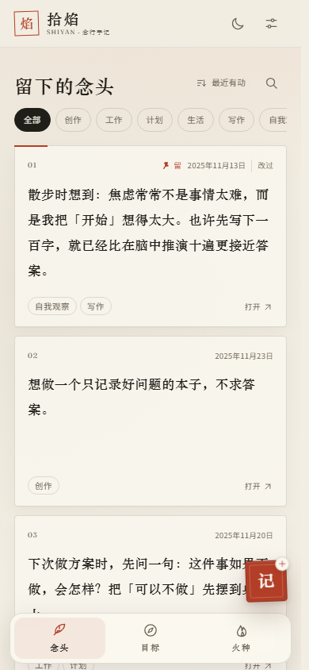
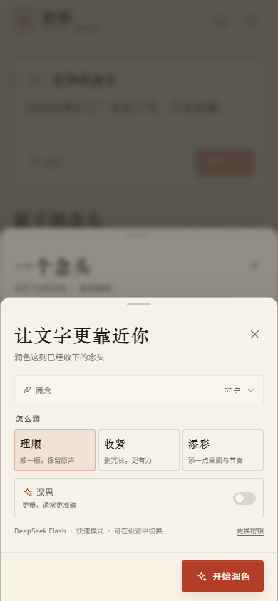
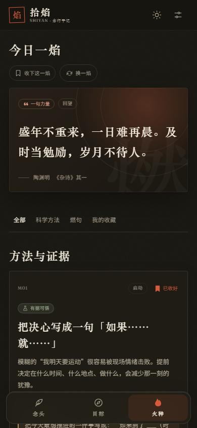
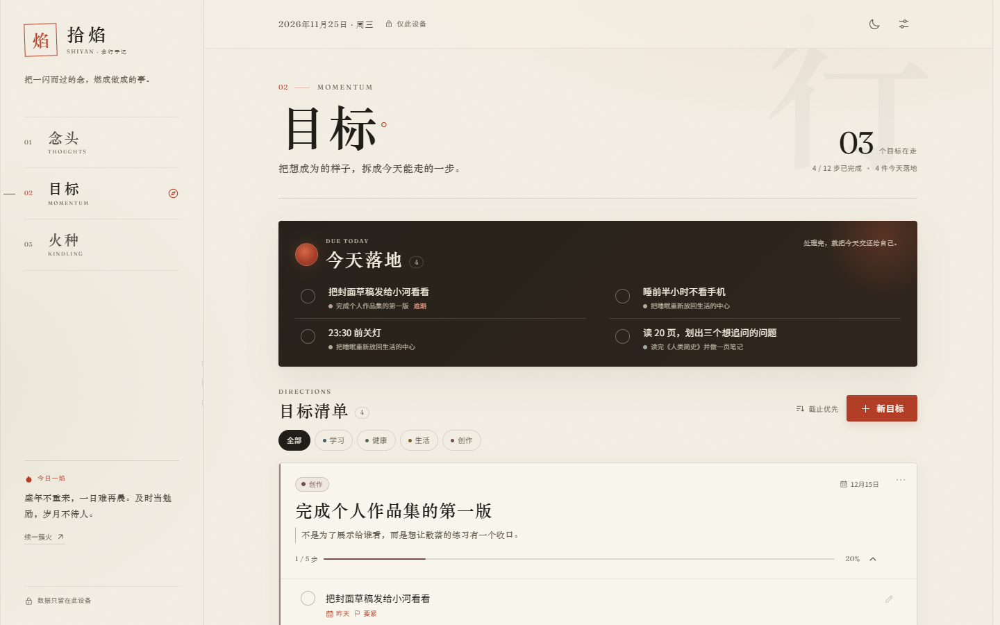

# 拾焰 · 念行手记

> 把一闪而过的念，燃成做成的事。

一个为个人使用而做的、**本地优先**的手机端 PWA。念头、目标、任务与收藏都只存在当前设备；
需要 AI 润色时，才把你主动选中的那段文字发送给 DeepSeek。

## 界面一览

<p align="center">
  
  
  
</p>

<p align="center">
  
</p>

## 能做什么

- **记下念头**：随时写、自动保留未发出的草稿；标签、置顶、搜索、筛选与排序。
- **AI 润色**：三种改法（理顺 / 收紧 / 文气），文气下可选三种笔法（冷硬 · 古龙、极简 · 海明威、本色 · 像你自己）。流式显示，支持深思模式、思考过程与结果撤回。
- **目标与任务**：分类、期限、要紧程度、今天到期清单、自动进度、自动归档已达成目标。
- **火种**：每天一张「今日一焰」；可展开研究依据的科学效率方法，以及标注出处与译文的燃句。
- **只属于你的数据**：无账号、无云同步、无广告、无追踪。数据保存在浏览器 IndexedDB 中，可随时导出 / 导入 JSON。
- **单文件版**：`npm run build:single` 生成一个自带全部资源的 `shiyan.html`，可直接发到手机离线打开。
- **离线可用**：安装为 PWA 后，应用外壳与界面无需网络也能打开；AI 润色才需要网络。
- **纸与墨**：暖白纸色与深夜墨色两套完整主题，或跟随系统。支持手机、窄窗口与宽屏。

## 为什么是本地优先

- 应用是纯静态站点，没有后端，也不会上传你的念头、目标或任务。
- DeepSeek API Key 保存在本设备的 IndexedDB 中，不会写入导出备份。
- 只有你在 AI 面板里主动发起润色的**当前这段文字**会发送到 `api.deepseek.com`。
  目标、任务、标签、其他念头都不会随请求发送。
- 导出备份时，API Key 会被自动排除。导入备份会覆盖当前念头与目标，但保留本机 Key。
- 清除浏览器站点数据、卸载应用或更换设备都会丢失本地数据。请定期「设置 → 导出备份」。

## DeepSeek 接入

1. 在 [DeepSeek 开放平台](https://platform.deepseek.com/api_keys) 创建 API Key。
2. 打开「拾焰 → 设置 → AI 润色」，粘贴 Key 并保存。
3. 写下念头后点「AI 润色」；也可以在某个已经保存的念头里再次润色。

已适配当前 DeepSeek API 的这些能力：

- 固定使用 DeepSeek V4.1 Flash（`deepseek-flash`），旧版模型设置自动迁移。
- 默认快速理顺，保留原文的事实和语气。可选收紧、文气和深思。
- 流式预览。只有完整结果可以替换原文，替换后可撤回。
- 用量与上下文缓存：读取 `stream_options.include_usage` 的 usage，展示缓存命中与思考 token。
- 浏览器端直连：DeepSeek API 支持跨域请求；不经过任何中转服务器。**Key 会存在于当前站点下**，
  因此不要把这套页面与共享 Key 一起使用。

检测连接时调用只读的 `GET /models` 检查 Flash 是否可用，不会产生模型调用费用。页面不内置任何 Key，也不会上传 Key
到 GitHub 或备份文件。

参考文档：[思考模式](https://api-docs.deepseek.com/zh-cn/guides/thinking_mode/) ·
[Chat Completions](https://api-docs.deepseek.com/zh-cn/api/create-chat-completion/) ·
[模型与价格](https://api-docs.deepseek.com/zh-cn/quick_start/pricing/)

## 本地开发

需要 Node.js 22+。

```bash
npm install
npm run dev
```

开发地址固定为 <http://localhost:7173>；端口被占用时直接报错，不会悄悄换端口。

生产构建与预览：

```bash
npm run build
npm run preview
```

生成一个可直接发到手机、双击打开的 **单文件 HTML**：

```bash
npm run build:single
```

产物为根目录的 `shiyan.html`（约 530 KiB），JS、CSS、字体和图标全部内嵌，不依赖服务器或
同目录文件。

手机上查看：

1. 把 `shiyan.html` 通过邮件、聊天工具或 AirDrop 发到手机；
2. 保存到「文件」后，用 Chrome / Safari 或支持 HTML 的文件查看器打开；
3. 部分聊天应用只会预览文本；若不能直接运行，请选择「用浏览器打开」。

单文件版不注册 service worker，因此不能「安装为 PWA」。数据是否能持久保存取决于手机浏览器
对 `file://` 页面的 IndexedDB / localStorage 限制；需要稳定的本地保存与离线安装时，请使用
GitHub Pages 部署后的版本。单文件版内的「导出备份」仍可用于保存内容。

检查类型：

```bash
npm run typecheck
```

## 部署到 GitHub Pages

部署配置已放在 `.github/workflows/deploy.yml`，会自动读取 Pages 的 `base_path`，因此项目页
（`https://用户名.github.io/仓库名/`）和自定义域名都能正常工作。

1. 在 GitHub 新建一个仓库（空仓库即可）。
2. 在仓库的 **Settings → Pages → Build and deployment** 中，把 **Source** 设为 **GitHub Actions**。
3. 把这个项目推到 `main` 分支：

   ```bash
   git init -b main
   git add .
   git commit -m "feat: 拾焰，本地优先的念行手记"
   git remote add origin https://github.com/你的用户名/你的仓库.git
   git push -u origin main
   ```

4. 等待 Actions 的 `Deploy 拾焰 to GitHub Pages` 工作流完成，部署地址会显示在 workflow 的
   deployment 环境与仓库 Pages 设置里。
5. 用手机浏览器打开地址，使用浏览器菜单中的「安装应用 / 添加到主屏幕」（iOS Safari 是
   「分享 → 添加到主屏幕」）。

> 静态站点无法在任何地方安全地替你隐藏 DeepSeek Key。拾焰采用「Key 只存在你自己的浏览器」
> 的个人使用方式，请不要把带有共享 Key 的页面公开给其他人使用。

## 项目结构

```
src/
  components/        通用按钮、弹层、图标、品牌、导航、Toast 等
  features/
    ideas/           念头、编辑器、AI 润色面板
    goals/           目标、任务、今天清单、编辑器
    fire/            今日一焰、科学方法、燃句与内容
    settings/        设置、数据备份、安装
  lib/
    deepseek.ts      DeepSeek Chat Completions / SSE / thinking / usage
    dataFormat.ts    本地数据解码、旧格式兼容与导入修复
    backup.ts        备份格式与导出
    storage.ts       IndexedDB 修订提交与备用副本恢复
    editJournal.ts   刷新或中断后的待保存编辑恢复
    operations.ts    数据操作和撤回规则
    store.tsx        应用状态与保存队列
  styles/            设计 token、布局、组件、页面与响应式样式
```

## 回归检查

```bash
npm run typecheck
npm test
MSYS2_ENV_CONV_EXCL=BASE_PATH BASE_PATH=/yxl-todo/ npm run build
npm run build:single
python -m pip install -r scripts/browser-requirements.txt
python -m playwright install chromium
npm run test:browser
```

浏览器检查会启动本地服务，验证子路径 PWA 的离线与更新流程，并直接从文件打开便携版。AI 检查使用模拟响应。

## 关于「火种」的科学内容

方法卡片尽量只写有公开研究支持、措辞可核对的内容，并把研究出处与 DOI / 来源链接放在卡片内。
心理学与行为科学的效应存在个体差异，这些内容是可试验的线索，不是成功保证。
外文引文为中文译文，已尽量贴近原意并标明「中文译文」。

## License

个人项目，未指定开源许可证；如需公开发布请自行补充 License。
